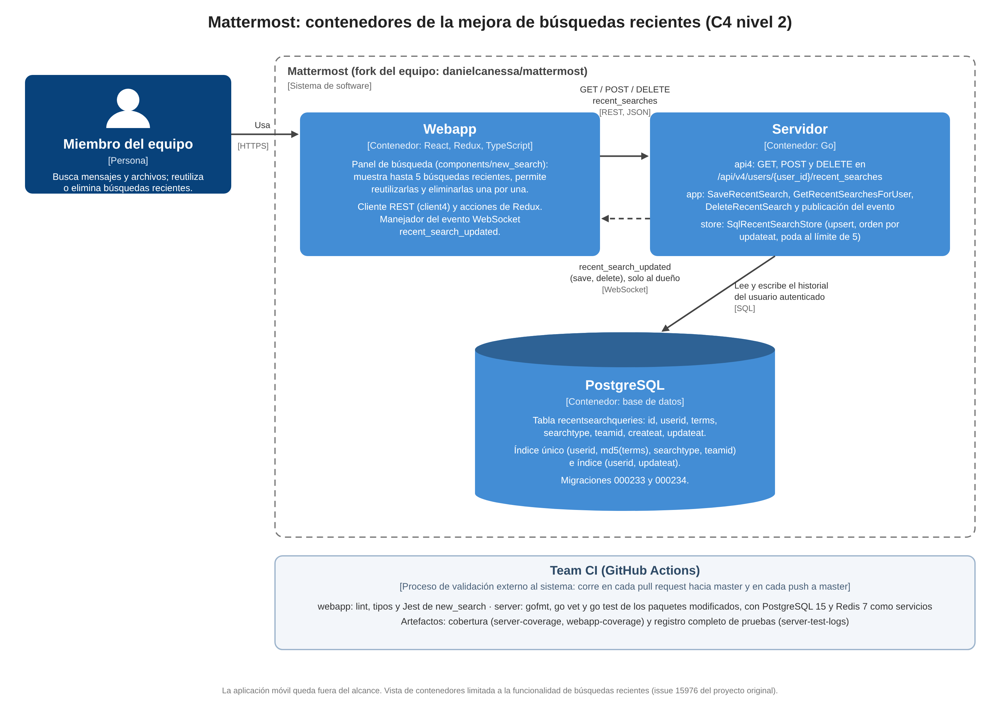
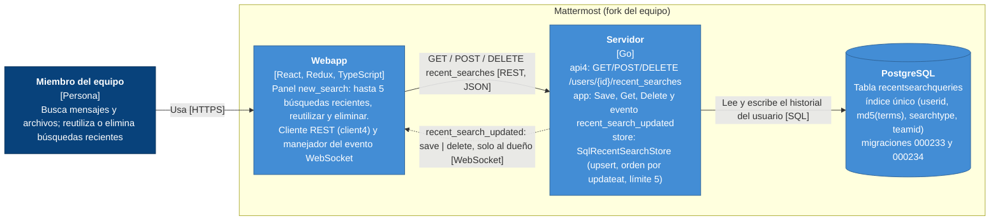

# Diagrama C4 · Nivel 2 (contenedores) de la mejora de búsquedas recientes

Complementa el [diagrama de contexto (nivel 1)](c4-context.md) con la vista de contenedores limitada a la funcionalidad implementada en este fork: la webapp consume tres rutas REST del servidor y recibe el evento WebSocket `recent_search_updated`; el servidor persiste el historial por usuario en PostgreSQL.

Versión en Mermaid (misma información, se renderiza en GitHub):

## Elementos

| Elemento | Tipo | Tecnología | Responsabilidad en la mejora |
|---|---|---|---|
| Webapp | Contenedor | React, Redux, TypeScript | `components/new_search/recent_searches.tsx` muestra hasta cinco búsquedas, permite reutilizarlas (`handleRerun`) y eliminarlas; `client4.ts` expone `getRecentSearches`, `saveRecentSearch` y `deleteRecentSearch`; `websocket_actions.ts` maneja `recent_search_updated`. |
| Servidor | Contenedor | Go | `api4/recent_search.go` (rutas y `requireRecentSearchOwner`), `app/recent_search.go` (reglas de negocio y publicación del evento), `store/sqlstore/recent_search_store.go` (upsert con `ON CONFLICT`, orden por `updateat`, poda a cinco). |
| PostgreSQL | Contenedor (base de datos) | PostgreSQL 15 | Tabla `recentsearchqueries` creada por la migración 000233 y ajustada por la 000234 (columnas `VARCHAR(26)` e índice único sobre `md5(terms)`). |

## Relaciones

| Origen | Destino | Protocolo | Descripción |
|---|---|---|---|
| Miembro del equipo | Webapp | HTTPS | Usa el panel de búsqueda. |
| Webapp | Servidor | REST, JSON | `GET`, `POST` y `DELETE` en `/api/v4/users/{user_id}/recent_searches`. |
| Servidor | Webapp | WebSocket | `recent_search_updated` con `action` `save` (item) o `delete` (id), enviado solo al usuario dueño. |
| Servidor | PostgreSQL | SQL | Lee y escribe el historial del usuario autenticado. |

## Alcance de esta vista

Se limita a los contenedores que participan en las búsquedas recientes. La aplicación móvil queda fuera del alcance. El proceso de validación (Team CI en GitHub Actions) se describe en el documento del segundo entregable y en `.github/workflows/team-ci.yml`.

[Volver al README](../../README.md#diagrama-de-arquitectura-c4)
