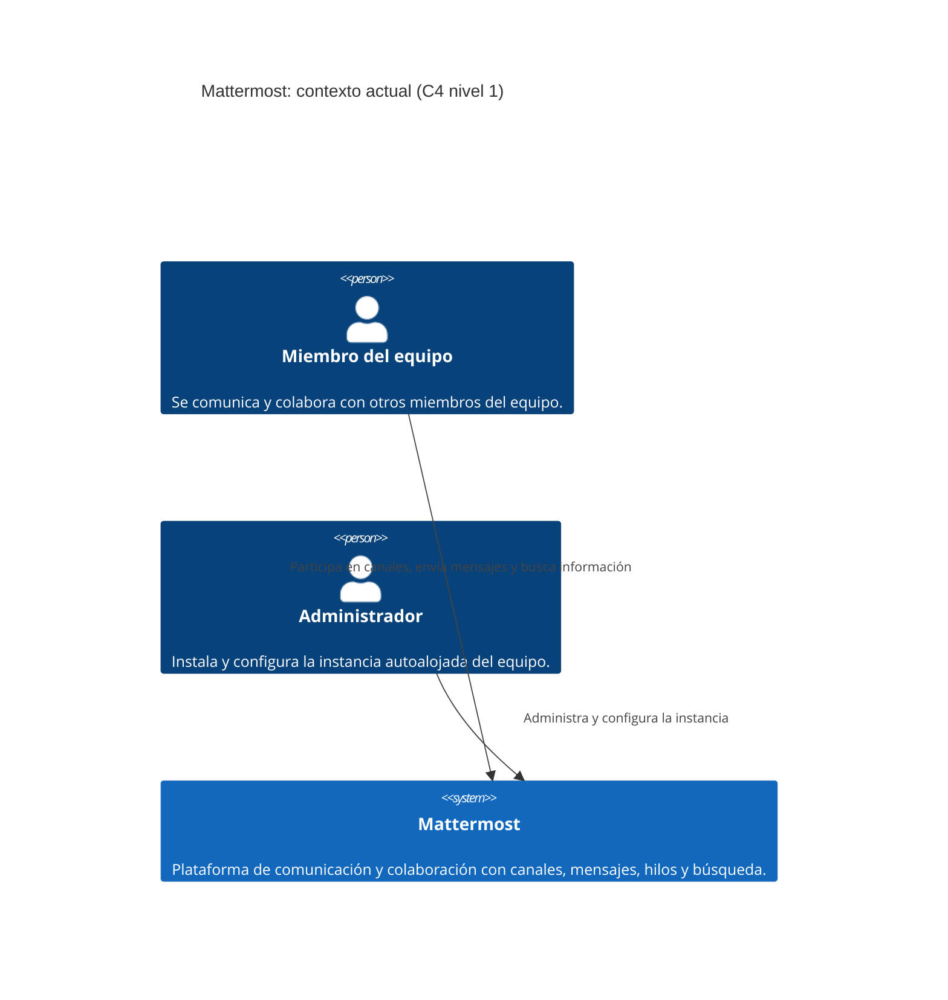

# Diagrama C4 · Nivel 1 (contexto)

Este diagrama presenta el contexto actual de Mattermost como parte del análisis del proyecto del equipo Foo.

La vista se centra en el sistema, sus principales usuarios y sus interacciones generales. El alcance de la mejora de búsquedas recientes se documenta por separado en el [README](../../README.md#alcance).

## Elementos

| Elemento | Tipo | Descripción |
|---|---|---|
| Miembro del equipo | Persona | Utiliza Mattermost para comunicarse, participar en canales y consultar información compartida. |
| Administrador | Persona | Instala, administra y configura la instancia de Mattermost del equipo. |
| Mattermost | Sistema de software | Plataforma de comunicación y colaboración que permite organizar conversaciones en canales, intercambiar mensajes, responder en hilos y buscar información. |

## Relaciones

| Origen | Destino | Descripción |
|---|---|---|
| Miembro del equipo | Mattermost | Participa en canales, envía mensajes y busca información. |
| Administrador | Mattermost | Administra y configura la instancia. |

## Alcance de esta vista

Mattermost se representa como un único sistema. Esta vista se limita a las relaciones con el miembro del equipo y el administrador; no detalla integraciones externas ni la estructura interna de aplicaciones, componentes o almacenamiento. Tampoco representa cambios futuros de la funcionalidad de búsquedas recientes.

[Volver al README](../../README.md#diagrama-de-arquitectura-c4)
